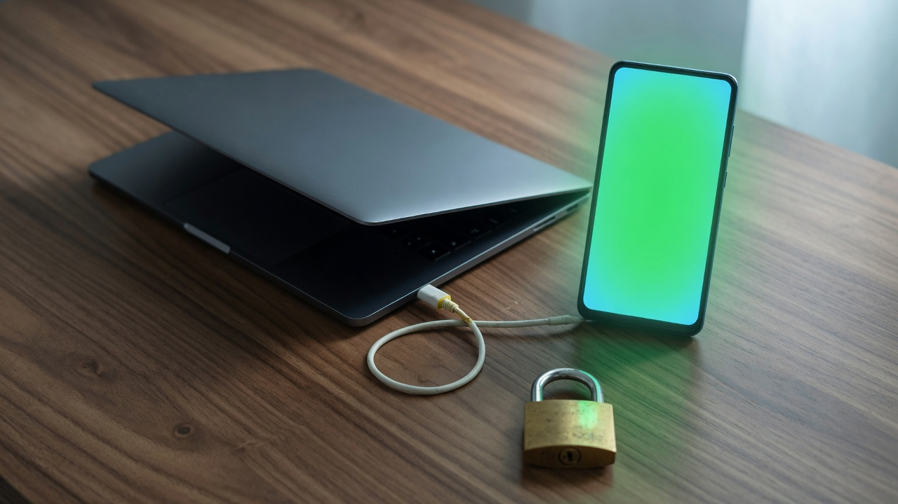

# iPhone Use

**한국어** · [English](README.en.md) · [中文](README.zh.md)



이 저장소는 [ZHONG XIN의 iPhone Use](https://github.com/zhongerxin/iPhone-use) 0.3.10을 바탕으로 한 공개 포크입니다. 원 프로젝트는 Codex가 USB로 연결된 iPhone을 읽고 조작하는 로컬 플러그인입니다. 라이선스는 MIT이고, 저작권 표시는 ZHONG XIN에게 있습니다.

설치 절차, 도구 목록, 화면 미리보기의 원문 안내는 [English](README.en.md)와 [中文](README.zh.md)에 두었습니다. 그 문서 안의 clone 주소는 업스트림입니다. 이 포크를 받으려면 아래 주소를 씁니다.

## 처음 보는 순서

1. 이 저장소를 클론하고 `sh scripts/install.sh`를 실행합니다.
2. 자기 iPhone을 USB로 연결하고, 자기 Apple 팀으로 WDA를 서명합니다. 다른 사람의 상태 디렉터리나 인증서는 복사하지 않습니다.
3. 기본값은 화면을 읽는 것뿐입니다. 탭과 입력은 직접 `IPHONE_USE_SAFETY_MODE=standard`로 바꾼 뒤에만 열립니다. 켜지지 않으면 안내가 그 한 줄을 돌려주고, 도우미가 모드를 바꾸지는 않습니다.

## 이 포크에서 바꾼 것

- 휴대폰의 화면 제어 포트는 빌드할 때 `127.0.0.1`에만 묶입니다.
- Mac의 전달 수신은 `127.0.0.1:18100`입니다. TLS 1.3이고, 클라이언트 인증서가 있는 연결만 HTTP로 이어집니다. 인증서는 처음 기동할 때 그 Mac의 상태 디렉터리에 만들어지며, 개인 키 파일은 모드 0600입니다.
- 기본 안전 모드는 `read-only`입니다. `read-only`와 `strict`는 탭, 입력, 앱 실행, 클립보드 쓰기, 설치와 서명 변경을 막습니다. 그런 동작은 `IPHONE_USE_SAFETY_MODE=standard`일 때만 열립니다.
- 사용 통계는 꺼져 있습니다. `IPHONE_USE_ANALYTICS=1`이고 `DO_NOT_TRACK`이 `1`이 아닐 때만 익명 이벤트를 보냅니다. 플러그인 실행 설정은 통계를 끄고 읽기 전용으로 둡니다. 범위는 [ANALYTICS.md](ANALYTICS.md)에 있습니다.
- 휴대폰으로의 전달이 8초 안에 붙지 않으면 그 시도는 끊습니다. 상태 확인이 실패하면 USB를 다시 연결하라는 다음 단계를 함께 돌려줍니다.

## 받는 사람이 직접 준비할 것

자신의 Mac, iPhone, USB 케이블, Apple 개발자 팀이 필요합니다. WDA Runner는 자신의 팀으로 서명해 휴대폰에 설치합니다. `~/.local/share/iphone-use`는 그 Mac에서 새로 생깁니다. 다른 사람의 상태 디렉터리, 인증서, 서명된 앱을 복사하지 않습니다.

무선으로 화면을 조작하는 기능은 이 포크에 없습니다.

```sh
git clone https://github.com/truth0530/iPhone-use.git
cd iPhone-use
sh scripts/install.sh
```

## 남아 있는 한계

- 같은 macOS 사용자로 실행되는 프로세스는 모드 0600인 클라이언트 키를 읽을 수 있습니다.
- 같은 Mac의 다른 프로그램은 USB로 휴대폰의 `127.0.0.1:8100`에 직접 연결할 수 있습니다. Mac 쪽 인증서 검사는 그 경로를 막지 않습니다.
- 도구로 화면을 읽으면 그 내용과 접근성 정보는 그 세션의 AI로 갑니다. 통계를 끄는 것과는 별개입니다.
- `standard`로 바꾸면 그 세션의 모델이 화면을 누르고 글을 넣을 수 있습니다.

## 출처

원 프로젝트는 https://github.com/zhongerxin/iPhone-use 입니다. Copyright (c) 2026 ZHONG XIN. MIT License. 고지와 [LICENSE](LICENSE)는 유지합니다. 휴대폰에서 도는 실행 서비스는 [WebDriverAgent](https://github.com/appium/WebDriverAgent)입니다. 제3자 고지는 [THIRD_PARTY_NOTICES.md](THIRD_PARTY_NOTICES.md)에 있습니다.
